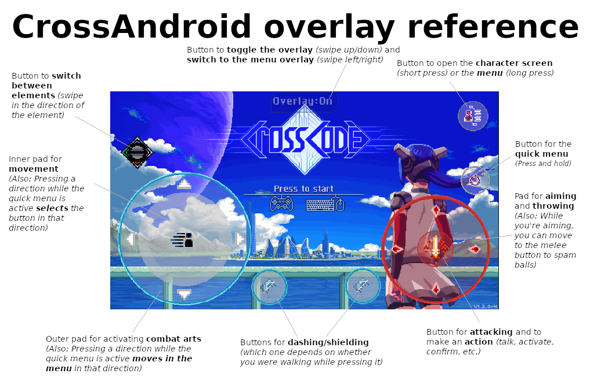

# CrossAndroid

Welcome to CrossAndroid! This is an app that allows you to play
CrossCode on your Android device.

Current features:
- Play CrossCode on the go!
- Browse, install, update and uninstall mods in the app, including the
  modloader (CCLoader2 or CCLoader3)
- Import your game folder straight from your device's storage
- Support for controllers connected to your phone, also in the
  launcher and Mods screen
- Includes a virtual controller layout _(for details see below)_
- Customize the virtual controller with size and transparency settings
  (you can even let it disable itself automatically during cutscenes)
- Sharp pixel scaling, Always Sprint and other gameplay settings
- Haptic feedback when the screen shakes _(experimental)_
- Import/Export saves between your PC and this app! _(for details, see
  below)_

Help improve the app by reporting bugs or making
suggestions for improvements.

## Credits
Main parts of CrossAndroid made by Namnodorel, Pixelart by Ichiki Hayaite aka TheSparkstarScope

## Getting the app
Install the [latest APK](https://gitlab.com/rumpnisse/crossandroid/-/releases) (or use Obtainium), then follow the [setup guide](SETUP.md) to copy the game files to your device.

You can update the app independently of the game files. To update the game, follow the [setup guide](SETUP.md) again. Mods are installed from the **Mods** screen in the app.

## Using the virtual controller
Here's an overview of the combat controls overlay:

**Important:** Do not change the controller binding settings in the
in-game options when you want to use the virtual controller! Doing so
will result in the virtual controller behaving in some weird and
unexpected ways.

Turning off the overlay will let you interact directly with the game
(click on buttons, etc.)

You can adjust the size and transparency of the virtual controller in
the settings of the app.

# Import/Export of saves
CrossAndroid lets you transfer save games between devices or between
your PC and this app. You can access the import and export features
from the two buttons on the launcher screen.

### Exporting saves from CrossAndroid
Tap "Export Save Games" on the launcher. You'll see a list of your save
slots with a preview of each (level, chapter, playtime, location, and
credits). Tap the export button on the slot you want, and choose where
to save the file on your device.

### Importing saves into CrossAndroid
Tap "Import Save Games" on the launcher. You have two options:
- **Import from files:** Select one or more previously exported save
  files from your device.
- **Import from string:** Paste a Save String directly.

Imported saves are queued and will be added to your saves list the next
time you launch the game.

### Exporting/Importing a Save String from/into CrossCode on your PC/Mac
On your PC/Mac, open the game, and press `F10` in the title screen/menu. A window will pop up
that lets you both copy the latest Save String and paste a Save String
to import into the game.

## Feedback
Speaking of suggestions: If you have any, suggest them either
[here](https://gitlab.com/rumpnisse/crossandroid/issues) or in the #crossandroid channel 
on the [Community Modding Discord Server](https://discord.gg/3Xw69VjXfW)
